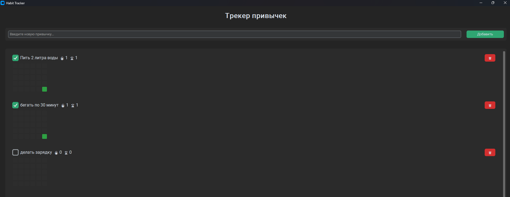

# 🌱 Трекер привычек (Habit Tracker)

Десктопное приложение для формирования и отслеживания ежедневных привычек с визуализацией прогресса и подсчётом серий выполнения.



## Возможности

-  **Добавление, удаление и отслеживание привычек** с подтверждением удаления
-  **Подсчёт текущей серии дней подряд** (streak 🔥) для каждой привычки
-  **Отображение рекордной серии** (best streak 🏆) за всё время
-  **Визуализация прогресса за последние 30 дней** (heatmap — как на GitHub)
-  **Локальное хранение данных** в SQLite (без облака и интернета)
-  **Тёмная тема интерфейса** на базе CustomTkinter
-  **Обработка некорректного ввода** (пустые строки и пробелы)

## Технологии

| Компонент | Технология |
| :--- | :--- |
| **Язык** | Python 3.10+ |
| **GUI** | CustomTkinter (современный интерфейс на основе Tkinter) |
| **База данных** | SQLite (встроенный модуль `sqlite3`) |
| **Платформа** | Windows / Linux / macOS (кроссплатформенное) |

## Установка и запуск

### 1. Установите Python
Скачайте и установите Python 3.10+: [python.org](https://www.python.org/downloads/)

> При установке обязательно отметить галочку **"Add python.exe to PATH"**

### 2. Установите зависимости
Откройте терминал в папке проекта и выполните:

```bash
pip install customtkinter
```

### 3. Запустите приложение
```bash
python main.py
```
База данных `habits.db` будет создана автоматически при первом запуске.

## Структура проекта

```text
habit-tracker/
├── main.py            # Точка входа, графический интерфейс
├── database.py        # Логика работы с базой данных SQLite
├── habits.db          # Файл базы данных (создаётся автоматически)
├── README.md          # Документация проекта
└── tracker.png        # Скриншот приложения
```

## Как пользоваться

1. **Добавить привычку:** введите название в поле ввода и нажмите «Добавить»
2. **Отметить выполнение:** поставьте галочку рядом с привычкой — квадратик в календаре станет зелёным
3. **Удалить привычку:** нажмите красную кнопку 🗑 (потребуется подтверждение)
4. **Отслеживать прогресс:** наблюдайте за зелёными квадратиками в календаре под каждой привычкой

## Реализованные алгоритмы

- **Подсчёт текущей серии (Streak):** Алгоритм проверяет даты выполнения от сегодняшнего дня назад. При первом пропуске подсчёт останавливается.
- **Подсчёт рекорда (Best Streak):** Алгоритм проходит по всем датам выполнения в хронологическом порядке и находит максимальную цепочку дней подряд.
- **Визуализация (Heatmap):** Сетка 5×6 квадратиков (30 дней). Зелёный квадратик — привычка выполнена, серый — пропуск.

## 👨‍💻 Автор

**Басал Али**  
Группа: 25.Б11-ПУ  
Учебный проект по программированию, 2026