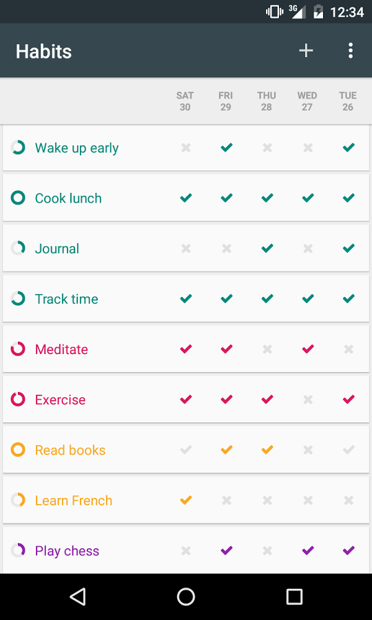
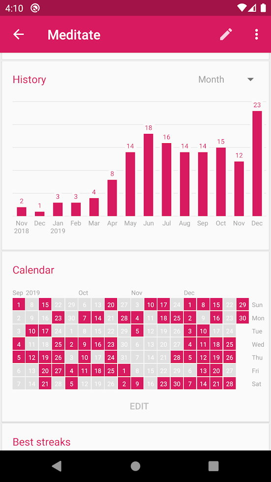
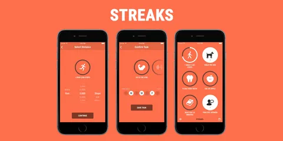

# Техническое задание

## Тема проекта: Разработка десктопного трекера привычек с визуализацией прогресса

**Автор:** Басал Али, 25.Б11-ПУ

---

### Основная идея

Разработка настольного приложения для формирования и отслеживания ежедневных привычек. Пользователь создаёт список привычек (например, «читать 30 минут», «пить 2 литра воды», «делать зарядку»), ежедневно отмечает их выполнение, а программа ведёт учёт текущей серии (streak) дней подряд и отображает общую статистику. Приложение мотивирует пользователя не прерывать цепочку выполненных дней.

---

### Существующие аналоги

- **Loop Habit Tracker** — open-source приложение для Android с графиками и подробной статистикой.
 
 
- **Streaks** — минималистичное приложение для iOS с интеграцией в Apple Health.
 
- **Habitica** — популярное кроссплатформенное приложение с геймификацией привычек (RPG-элементы, награды, групповые челленджи).

  
**Отличие проекта:** реализация в виде легковесного десктопного приложения для Windows/Linux с фокусом на простоту и скорость работы. В отличие от мобильных аналогов, проект не требует смартфона и синхронизации с облаком — все данные хранятся локально, что обеспечивает приватность и мгновенный запуск.

---

### Функционал

1. **Управление привычками (CRUD):**
   - Создание новой привычки с указанием названия и иконки/цвета.
   - Редактирование названия и параметров существующей привычки.
   - Удаление привычки с подтверждением.

2. **Ежедневная отметка выполнения:**
   - Отображение списка привычек на текущий день с чекбоксами.
   - Возможность отметить/снять отметку одним кликом.
   - Автоматическое определение текущей даты и сброс чекбоксов в полночь.

3. **Подсчёт серии (Streak):**
   - Автоматический подсчёт количества дней подряд, в которые привычка была выполнена.
   - Сброс серии при пропуске дня.
   - Отображение рекордной серии (best streak) для каждой привычки.

4. **Визуализация прогресса:**
   - Мини-календарь (heatmap) за текущий месяц: дни с выполненными привычками подсвечиваются зелёным, пропущенные — серым.
   - Отображение общего процента выполнения за неделю/месяц.

5. **Локальное хранение данных:**
   - Все данные сохраняются в локальной базе данных SQLite.
   - Автоматическое сохранение при каждом действии пользователя.

---

### Язык и платформа

- **Язык:** Python 3.10+
- **Платформа:** Windows / Linux (кроссплатформенное)
- **GUI-фреймворк:** CustomTkinter (современный внешний вид на основе Tkinter, поддержка тёмной/светлой темы)
- **База данных:** SQLite (встроенный модуль `sqlite3`, не требует установки сервера)
- **Дополнительные библиотеки:** `datetime` (работа с датами), `calendar` (построение календаря)

---

### Инструменты разработки

- **AI-IDE:** Cursor / Windsurf.
- **LLM-помощник:** GPT-4 / Claude 3.5 Sonnet / Gemini.
- **Система контроля версий:** Git + GitHub.
